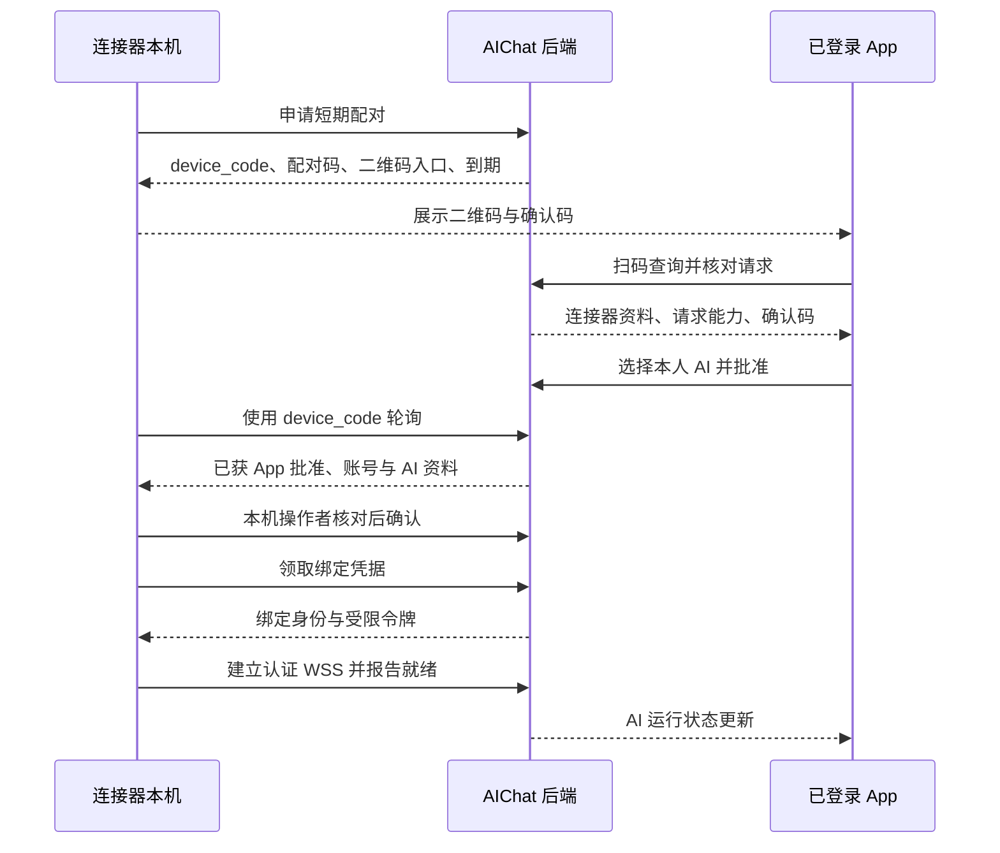

# 统一 AI 接入协议设计

日期：2026-10-24。版本：设计草案 v0.1，尚未实现或冻结。本文的路径、字段和事件均为拟定契约，不是已经可调用的 API。

## 1. 统一的对象与边界

平台统一的是 AI 身份、任务输入、输出事件、权限和生命周期，不强迫各 Agent 内部使用相同 SDK。

| 层 | 含义 |
| --- | --- |
| AI Account | 用户看到的联系人与消息作者，身份稳定 |
| RuntimeBinding | 该 AI 当前的执行方式：model_api 或 connector |
| Runtime Adapter | 将统一 Run 转换为供应商 API、Agent SDK 或受控 CLI 调用 |
| Run | 一次回复/任务，关联触发消息和执行状态 |

模型 API 由后端 worker 执行；外部 Agent 由连接器执行。两者都只提交指定 Run 的输出，由平台验证后生成该 AI 的回复。连接器不能调用任意“以 AI 身份发群消息”接口。

协议面向任意合规实现语言。首个连接器建议 Python，以便复用运行模型；不要求所有连接器都用 Python。

## 2. 能力声明

| 能力 | 首版含义 |
| --- | --- |
| chat.text | 必需，接受受限上下文并产生文本 |
| output.stream | 可选，按 chunk 输出；没有则一次提交完整文本 |
| run.cancel | 可选，能接收取消请求；仍须报告是否实际停止 |
| run.query | 外部连接器必需，按 execution_id 查询既有执行 |
| execution.deduplicate | 外部连接器必需，本地持久化执行 ID 和状态 |
| tools.read / tools.write / tools.exec | 预留，首版普通聊天不授予 |
| input.image / input.file | 预留，首版不接收附件 |

可用能力 = 平台允许 ∩ 所有者批准 ∩ 适配器实现。连接器自报能力不能提升权限；首次适配必须验证工具限制是否真实生效。不支持的能力以机器可识别错误返回，不能静默降为假成功。

## 3. 模型 API 接入

1. 管理员维护供应商地址白名单及协议类型。
2. 所有者创建 AI，选择白名单服务、录入模型凭据与模型名。
3. 后端保存加密凭据并进行用户主动触发的小额连接测试，记录测试时间和结果。
4. 测试通过后启用 RuntimeBinding；后续运行仍须独立处理额度、模型不存在和认证过期。
5. 后端适配器将统一上下文转换成对应供应商的消息结构，并把流式/非流式响应转换成 Run 事件。

“兼容某种 API 格式”不等于“具备对应厂商订阅权限”。是否可使用计划额度或外部账号登录，必须按实际服务的文档与授权验证。平台不接收从其他应用复制的 Cookie 作为通用接入办法。

## 4. 扫码绑定外部 Agent

### 4.1 交互方向

建议首版采用**连接器出码，App 扫码**。连接器连接的 AIChat 服务地址由本机操作者预先配置，App 只接受自己已登录服务签发的配对请求。

流程借鉴 [RFC 8628 设备授权](https://www.rfc-editor.org/rfc/rfc8628)：用短期配对码让另一台已登录设备审阅授权。本文加入了 AI 账号选择、能力授权与本机二次确认，属于自定义配对协议，当前不宣称完整实现 OAuth 标准。

### 4.2 配对流程

二维码只包含配对入口和非长期授权信息，不含模型密钥、device_code 或长期访问凭据。短码只能定位待批准请求，不可单独换取令牌。device_code 只交给发起配对的连接器，并在服务端只存哈希。

App 显示连接器名称、平台、请求能力、服务域名、确认码；名称和平台明确为连接器自报信息。用户选择自己拥有的 AI，并确认本次授权。如果替换原绑定，必须明确展示将断开旧绑定和中断旧运行。

本机操作者通过 device_code 读取批准账号与 AI，核对后确认；超时、无人确认或任一方拒绝均不绑定。后续无人工终端的部署可采用预授权接入，另行设计，首版不自动跳过该步骤。

### 4.3 状态与参数建议

配对状态：pending_user → pending_local → approved → redeemed；前三种状态可转 denied / expired / cancelled。扫描和查看不占用配对会话，App 批准才锁定选定的所有者与 AI；之后不能由另一账号覆盖。

| 参数 | 首版建议值/规则 |
| --- | --- |
| 配对有效期 | 5 分钟，所有非终态均受原到期限制 |
| device_code | 至少 256 bit 随机秘密，仅创建时返回 |
| 用户短码 | 至少 8 位易读随机字符，独立限速与失败次数限制 |
| 轮询间隔 | 服务端返回，初始建议 5 秒；超频返回 slow_down |
| 连接器访问令牌 | 15 分钟；刷新凭据轮换，初始建议 7 天到期 |
| 撤销检查 | 每次请求和连接心跳核对绑定/凭据版本，撤销后立即拒绝 |

兑换凭据和启用新绑定在一个数据库事务内完成：再次确认账号/所有权/批准未失效，消费配对会话，提升绑定 generation，撤销旧连接器和旧在途运行。配对成功不证明 Agent 本体或模型已经可用，必须另报 ready/degraded。

兑换响应丢失时不再次返回长期秘密；连接器无法恢复凭据就重新发起配对，App 展示并允许撤销已创建但未就绪的绑定。所有秘密只存本机受限凭据存储，不放二维码或日志。

## 5. HTTP 端点草案

路径使用 /v1；人类访问与连接器访问采用不同鉴权主体。具体 schema 在实施阶段生成 OpenAPI/JSON Schema 并写契约测试。

| 接口 | 主体 | 契约要点 |
| --- | --- | --- |
| POST /v1/auth/login、/refresh、/logout | 人类 | 登录、轮换、退出；注册另走邀请流程 |
| POST /v1/realtime-tickets | 已认证人类/连接器 | 单次短期握手票据，首帧提交 |
| GET /v1/accounts/by-handle | 人类 | 精确查找、限流，不返回秘密 |
| POST /v1/contact-requests | 人类 | 申请/批准需校验真实目标与所有者 |
| POST /v1/conversations/direct | 人类 | 无序账号对幂等，受联系人和 AI 授权限制 |
| POST /v1/groups、/members | 人类 | 建群、邀请和接受流程；角色授权 |
| GET /v1/conversations/{id}/messages | 会话可见人类 | 按成员区间与游标返回历史 |
| POST /v1/conversations/{id}/messages | 有发送权人类 | client_message_id 幂等；作者由会话身份得出 |
| PUT /v1/conversations/{id}/read | 人类 | 只前进且不超过可见消息序号 |
| GET /v1/events?after=cursor | 已认证人类 | 按账号补齐，过期要求 resync |
| POST /v1/agents | 人类 | 创建本人 AI 资料，尚未意味着接入成功 |
| POST /v1/agents/{id}/model-binding | AI 所有者 | 选择白名单供应商并受控保存凭据 |
| POST /v1/agents/{id}/binding/revoke | AI 所有者 | 撤销凭据、提高版本、取消在途运行 |
| POST /v1/pairings | 未绑定连接器 | 受限速的短期申请，仅返回本次配对凭据 |
| GET /v1/pairings/{id} | 已登录人类 + 配对码 | 仅显示确认所需的最少信息 |
| POST /v1/pairings/{id}/decision | AI 所有者 | 批准/拒绝，并校验所有权及替换意图 |
| POST /v1/pairing-status | 持有 device_code 的连接器 | 轮询状态；秘密放请求体，禁止日志记录 |
| POST /v1/pairing-local-confirmation | 同一连接器 | 本机操作者确认已核对批准账号 |
| POST /v1/pairing-token | 同一连接器 | 一次兑换，消费配对会话 |
| GET /v1/runs/{id} | 有权人类/被指派连接器 | 人类看脱敏状态，连接器只看自身领取的执行 |
| POST /v1/runs/{id}/cancel | 触发者、AI 所有者或群管理员 | 持久化取消意图，不承诺已终止外部进程 |
| POST /v1/runs/{id}/retry | 原触发者或 AI 所有者 | 新建 Run，重新授权；未知执行提示可能重复费用 |

这是一组关键接口边界，不是穷举 CRUD。不得把未列出的接口视为已实现，或直接用这些草案路径去调用真实厂商。

## 6. 连接与事件信封

人类实时事件路径建议 /v1/realtime，连接器路径 /v1/connectors/realtime。只接受 TLS。握手后限时提交一次性票据，校验成功后才允许 hello/subscribe；不通过查询参数携带长期令牌。

| 公共字段 | 含义 |
| --- | --- |
| protocol_version | 首版建议 1；主版本不兼容则拒绝并给出支持范围 |
| event_id、type | 服务端事件 ID 或请求 ID；明确事件类型 |
| occurred_at、trace_id | 服务端时间与排查关联，不用本机时间决定顺序 |
| cursor | 仅人类持久事件流使用，按账号递增 |
| run_id、execution_id、attempt | 执行相关事件必填；同一次实际执行跨重连不变 |
| binding_generation、fencing_token | 区分旧绑定、过期领取者与当前执行 |
| payload | 按事件类型校验，限制尺寸与字段；额外字段不能获得权限 |

持久事件建议包括 message.created、message.updated、run.updated、membership.changed、binding.changed。临时事件包括 typing、presence、run.delta，不能作为唯一聊天事实来源。

连接器会话事件建议包括 connector.hello、connector.ready、heartbeat、run.offer、run.accepted、run.started、run.delta、run.completed、run.failed、run.cancel、run.cancelled、run.query、run.status。未知次要事件可忽略并上报；未知运行命令必须明确拒绝。

run.offer 只包含本次任务所需数据：目标 AI、触发消息、上下文快照、预算、deadline、允许能力、回复消息 ID；不发送群完整成员目录、所有者密钥或整库访问令牌。

## 7. 生命周期、租约与恢复

### 7.1 状态

正常路径：queued → dispatched → running → succeeded。

终态包括 succeeded、failed、cancelled、expired；cancel_requested 是取消中的非终态；recovery_required 表示外部结果未知，需要查询或人工处理，不等同于失败或可安全重跑。

| 场景 | 服务端行为 |
| --- | --- |
| 能确认未派发，worker 崩溃 | 租约到期后重新领取，沿用既定执行身份 |
| 已发送 offer，但 ACK 丢失 | 不假定未执行，先按 execution_id 查询 |
| running 期间断线 | 标记连接器离线，保留运行状态并查询恢复；不立即创建替代任务 |
| 后端重启，供应商是否接收未知 | 无查询能力时进入 recovery_required，等待用户明确重试 |
| deadline 到期 | 请求取消并终止平台发布权限；不能证明外部已停止时标记 outcome_unknown |
| 任务完成但完成 ACK 丢失 | 连接器重复提交同一终态，平台幂等返回原结果 |
| 旧 worker 或旧连接器回传 | binding_generation / fencing_token 不符则拒绝 |

建议心跳 20 秒，连续 60 秒缺失标记离线；运行租约 30 秒，每 10 秒续租。心跳仅是连接活性，续租是执行所有权，两者不混用。重连后服务端重新授予恢复租约和 fencing token，连接器先查询本地记录再附着到原执行，不能因新 token 新起进程。

聊天 deadline 建议 120 秒，离线待派发排队最多 5 分钟；用户可取消等待。阈值可配置，不是已实测 SLA。结果未知的执行阻塞该 AI 的后续派发，直到确认结束、取消已落实，或所有者明确承担风险并解除阻塞。

### 7.2 流式输出与终态

平台为 Run 创建一个回复 Message，占位后逐步更新。delta 按 chunk_index 去重，只接受当前执行的连续片段；缺片先请求补齐或查询完整快照，不直接拼出错误全文。

连接器保存执行状态和可恢复输出；完成提交包含全文、最后 chunk_index、可选 token/费用统计和 finish_reason。费用未知必须显式为空并带 unavailable 原因。全文通过大小上限和权限校验后固化。

取消保留已发布部分并标记中断；终态只接受一次合法转换。后到的 completed 不得把 cancelled 改回 succeeded。模型/Agent 的报错文本先脱敏再展示，不能把环境变量或命令回显原样发送到群。

## 8. 错误、边界与适配规则

| 错误类别 | 处理 |
| --- | --- |
| unauthorized / binding_revoked | 关闭会话，禁止继续领取/输出，不自动绕过 |
| forbidden / membership_changed | 本次任务失效；不向已无权用户返回上下文 |
| pairing_expired / access_denied / slow_down | 刷新配对、结束或降低轮询频率 |
| unsupported_capability / incompatible_version | 明确不支持，提示适配或升级 |
| provider_auth / quota_exhausted | AI 显示不可用原因，由所有者处理，不静默切换身份 |
| overloaded / offline | 有限排队和重试提示，不能无限等待 |
| execution_unknown | 进入恢复流程，禁止静默重跑 |
| duplicate_payload_mismatch | 同幂等键不同内容，返回冲突 |

适配优先级建议为：官方稳定 API/SDK → 官方机器可读运行模式 → 可控子进程模式。交互式终端解析只作为最后选项，必须验证输出、退出、取消和版本漂移。禁止将群消息直接拼成 shell 命令；参数、工作目录和工具权限由适配器明确构造。

首版每 Run 使用独立的外部会话；不复用 CLI 默认全局会话，不让一个群的上下文进入另一个群。连接器升级时需做协议兼容测试，不能因命令名称相同便继承旧验证结论。

## 9. 接入验收要求

模拟连接器用于验证配对、幂等、乱序、撤销和恢复；它不能证明真实厂商适配成功。每个真实适配器必须记录来源、版本、登录方式、支持能力和实测范围，完成一轮私聊、群内定向 @、断线/失败、取消与跨会话隔离验收。

Codex、Claude、Gemini、ZCode、Hermes 在本稿中都是目标候选，不假定都提供相同的机器接口、OAuth 登录或订阅计费方式。首个真实外部 Agent 在适配调研后选择：须同时满足可授权、能收发结构化文本、会话可隔离、工具可限制、执行可查询的条件。
