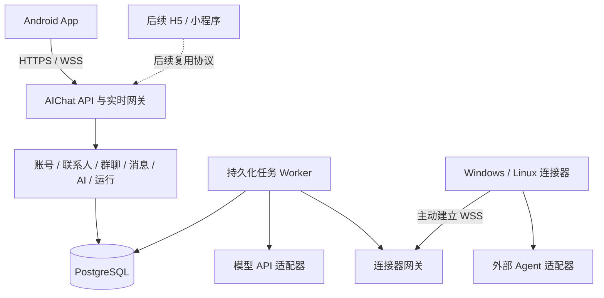

# AIChat 项目最终架构

设计日期：2026-10-24；实现状态更新：2026-10-26。“最终”沿用项目文档约定，后续可随验证调整。本文保留目标设计；当前实现和验证以 README、统一接口规约及审核记录为准。

## 1. 依据、当前状态与约束

当前对外分工：H5 `aichat.wsnbb.shop` 经 Cloudflare 橙云；所有平台 API/WSS 使用灰云 `api.aichat.wsnbb.shop`。Caddy 分别服务静态页面和反代后端，后端按精确 Origin 开放 H5 CORS；入口 HTML 不缓存、哈希静态资源长缓存。两个域名仍由同一台主机承载，未来可独立迁移。

用户确定：先做 App，后做 H5 与小程序；人类和 AI 均有账号、私聊、群聊；统一接入同时支持模型 API 与外部 Agent 连接器，连接器支持扫码绑定。最初设计阶段结束后，现已进入编码和审核阶段。

当前源码位于 `services/server`、`apps/mobile` 和 `connectors/connector-runner`。FastAPI 单进程内运行派发、扇出和维护循环；生产已用 Docker Compose + PostgreSQL，H5/HTTPS 入口为 https://aichat.wsnbb.shop，由同机 Docker Caddy 提供。SQLite 与隔离 PostgreSQL 均已通过后端回归，正式库迁移、备份恢复与基础 HTTPS/WSS 验收完成。独立 worker 入口尚不能与 API 安全共享实时枢纽，暂不按拆进程方案部署。具体结果与未验收项见 [部署说明](deploy/README.md) 和 [项目审核记录](docs/项目审核记录.md)。

设计以小规模封闭使用为起点，保留多人隔离。首版建议 Android、文本聊天、单服务部署、一个真实模型适配器和一个真实外部 Agent 适配器。H5、小程序、公开运营、文件执行与自主多 Agent 循环不进入首版交付。

## 2. 方案取舍

### 2.1 接入形态

| 方案 | 优点 | 代价与结论 |
| --- | --- | --- |
| 仅模型 API | 调用链短，统一文本回复容易 | 无法承载现有 Agent 的会话与运行环境；不符合本次确认的范围 |
| 仅外部 Agent 连接器 | 可保留本机工具与现有 Agent | 简单模型聊天也需要部署执行器；不作为唯一通路 |
| 模型 API + 外部连接器 | 同一 AI 身份可使用不同运行方式，保留扫码接入 | 要定义统一运行契约；**用户已选择** |

### 2.2 客户端

| 方案 | 取舍 |
| --- | --- |
| uni-app + Vue 3 + TypeScript | 建议采用；与未来 H5/微信小程序方向一致，平台能力单独适配 |
| Kotlin Android | 原生整合自由度高，但 H5/小程序需要另外构建界面 |
| Flutter | 可构建 App 与 Web；微信小程序不作为默认同源码承诺 |

用户尚未锁定技术栈。uni-app 的跨端与 Vue 支持边界以[官方说明](https://uniapp.dcloud.io/tutorial/vue3-basics)为准；这是本次选型建议，不是性能或打包可行性实测结论。

### 2.3 服务端

采用 Python + FastAPI + PostgreSQL，使用模块化单体及独立 worker。理由是统一处理 HTTP、WebSocket 与 Python Agent 适配，初期无需微服务运维。FastAPI 有 [WebSocket 官方支持](https://fastapi.tiangolo.com/advanced/websockets/)，但可靠消息和任务队列需要项目自己实现。

TypeScript + NestJS 曾是设计稿 D-02 的默认建议；**2026-10-25 经用户批准确定改用 Python**（见 docs/设计决策与验收.md D-02 修订记录），理由：服务端与连接器统一 Python、实现与测试已成、换语言无功能收益。Redis、专用消息队列、对象存储和 Kubernetes 首版不引入；可靠性依赖数据库事务和租约，不依赖进程内列表。

## 3. 系统组成

连接器主动向后端建立连接，不要求手机能访问执行器，也不要求执行器暴露公网入站端口。图中模块是逻辑职责，不代表每项都是独立服务器。

## 4. 模块职责与边界

| 模块 | 拥有的业务与数据 | 主要接口/边界 |
| --- | --- | --- |
| identity | 人类/AI 统一账号、登录设备、会话撤销 | 人类登录；AI 服务身份只能经受限接入使用 |
| contacts | 联系人申请、关系、拉黑 | 私聊和邀请前授权检查 |
| conversations | 私聊唯一性、群、成员区间、角色 | 加入/退出/移除、历史可见范围 |
| messages | 消息、引用、@、消息序号、未读游标 | 先持久化后广播，不把文本 @ 当命令解析 |
| agents | AI 所有权、使用授权、能力、模型配置和运行绑定 | 一个 AI 首版一个启用绑定，绑定版本用于撤销旧任务 |
| pairing | 配对会话、App 授权、连接器本机确认、凭据发放 | 绑定操作独立于聊天与厂商登录 |
| runs | 触发规则、上下文快照、预算、任务状态和取消 | 统一调度模型适配器与外部连接器 |
| realtime | 事件订阅、断线恢复、连接器会话、在线状态 | 每次订阅和投递校验当前权限 |
| runtime adapters | 模型协议转换、外部 Agent 进程/SDK 对接 | 只处理执行差异，不拥有账号和群权限 |
| audit | 登录、绑定、授权变更、运行终态的审计 | 脱敏记录，不收集完整密钥、原始 prompt 或工具日志 |

群聊编排是 runs 模块内的显式路由策略，首版不另建自主总控系统。Hermes 可以是一个普通 AI 账号；后续若作为调度 Agent，也必须遵守同一权限、轮次与预算协议。

## 5. 领域与数据设计

以下是逻辑实体及约束，不是 SQL、迁移文件或已经冻结的物理表。

| 实体 | 关键属性/约束 |
| --- | --- |
| Account | 不可变 ID、唯一 handle、类型 human/ai、资料、状态 |
| HumanCredential / LoginSession | 密码哈希、令牌哈希、设备、到期、撤销；明文密码不存储 |
| AgentProfile | AI Account 一对一、owner_account_id、可见性、策略版本 |
| AgentGrant | AI 与被授权人类、允许用途、限额、撤销时间 |
| ContactRequest / Contact / Block | 申请状态、无序账号对唯一联系人关系；拉黑保留方向 |
| Conversation | direct/group、群主、状态、消息序号计数器、权限版本 |
| DirectPair | 排序后的两账号 ID 唯一；防止同对账号创建多个私聊 |
| MembershipInterval | 账号、角色、加入/退出位置；重复入群形成新可见区间 |
| Message | 会话、conversation_seq、作者、内容、引用、mentions、client_message_id、状态 |
| ReadCursor | 人类账号/会话、last_read_seq，只能向前且不越过可见范围 |
| RuntimeBinding | AI、mode、配置引用、generation、启用状态；每 AI 仅一条有效绑定 |
| ProviderCredential | 所有者、供应商、加密密文和版本；加密主密钥独立保存 |
| Connector / ConnectorSession | 绑定、凭据版本、平台、能力、心跳、连接代次 |
| PairingSession | 随机配对 ID、秘密 device_code 的哈希、短码、到期与双方确认状态 |
| Run | AI、触发消息、上下文快照、绑定/权限版本、deadline、预算、状态 |
| RunAttempt | 尝试次数、幂等 execution_id、租约、fencing token、外部引用 |
| RunContextItem | 对本次运行可见的消息 ID/内容版本和截断信息 |
| OutboxEvent / InboxEvent | 事务性待发布事件；每个订阅账号持久化单调 cursor |
| AuditEvent | 操作者、对象、变更、时间、request_id，不存秘密 |

唯一约束至少覆盖：账号名；DirectPair；联系人无序对；Message 的会话序号；发送者与 client_message_id；触发消息与目标 AI 的自动运行；每个 Run 的回复 Message；绑定的有效唯一性；事件来源与收件账号的投递唯一性。

RunContextItem 首版保存受限文本快照供恢复执行，遵守与消息相同的访问控制。终态后建议 7 天清理内容快照，保留 ID、摘要哈希、截断和运行元数据；该时间是可配置默认值。聊天记录默认保留到用户执行未来的数据删除流程，首版明确不提供“隐藏会话即彻底删除”语义。

## 6. 消息、事件与实时一致性

### 6.1 写入流程

1. App 通过 HTTP 提交消息，带 client_message_id；服务端从登录会话决定作者，不信任客户端传入 sender_id。
2. 检查账号、联系人/成员、AI 授权、引用与 mentions。@ 目标必须属于会话，消息不能夹带另一会话的引用。
3. 锁定会话的短事务内分配 conversation_seq，保存消息、需要创建的 Run 和 outbox 事件。同一幂等键重试返回原结果，内容不同则拒绝。
4. 提交后才返回“已发送”。worker 处理任务，outbox 投递器生成每个有权账号的 InboxEvent。
5. WSS 推送已提交事件；网络失败可重投。客户端按 event_id 去重、按服务端序号显示消息，不以设备时间排序。

消息、Run 和 outbox 要么一起提交，要么一起失败，防止“有消息无任务”。数据库锁只覆盖提交，不覆盖模型调用。

### 6.2 补齐与流式输出

每个账号有独立的持久事件 cursor，客户端记住已应用 cursor。重连先订阅并进入缓冲状态，再取高水位快照与补齐至该水位，然后按 cursor 应用缓冲事件，避免读取与订阅之间漏事件。

首版建议事件保留 7 天；过期返回 resync_required，客户端重新拉取有权会话快照和消息。退出成员的旧事件在读取时再次检查可见区间，不能通过重放拿到离开后的内容。

conversation_seq 排列持久消息，不给每个 token 分配聊天消息序号。AI 流式 delta 使用 run_id、attempt、chunk_index；重连缺片时取当前回复快照及 offset。部分回复建议每 1 秒或累计 4 KiB 做数据库 checkpoint，完成时原子固化全文与终态。突发崩溃可能丢失最后一段未 checkpoint 内容，界面明确标记中断。

消息状态更新与终态都有持久化事件。慢客户端丢弃可恢复的 delta 后拉快照，不无限堆积内存。客户端提交统一走 HTTP，WSS 用于事件与运行协议，避免首版同时维护两套聊天写入命令。

### 6.3 后台运行

App 退到后台或被系统终止时，后端已接受的任务继续执行；聊天恢复后补齐。首版不承诺熄屏实时通知。Android 对后台进程与网络行为存在系统和厂商限制，参见[官方背景任务说明](https://developer.android.com/develop/background-work/background-tasks/bg-work-restrictions)。厂商推送作为后续独立交付，不能用 WebSocket 长连替代到达率验收。

## 7. AI 调度与执行一致性

### 7.1 触发和上下文

私聊的人类消息自动触发对应 AI；群聊只为有效的显式 @ 创建任务。AI 输出首版不触发其他 AI。引用只影响上下文，不隐含触发。触发目标由后端验证结构化账号 ID。

同一消息 @ 两个 AI 时分别生成 Run，使用同一触发时刻的会话上限，各自按其权限形成快照。上下文包括 AI 的角色提示、当前触发、授权区间内最近消息与可见引用，不包括所有者其他私聊、任意本地文件或加入前内容。首版建议最近 30 条，按适配器可用 token 预算再截断；当前触发消息不得静默删除，超限应明确拒绝。

每个 AI 首版最多并发 1 个 Run，每个人类账号最多 2 个在运行的任务；每 AI 待执行最多 20 个，超限返回可重试错误。多 AI 可并行，人类新发消息不自动取消旧 Run，可显式停止。达到预算或 deadline 停止继续派发。

### 7.2 持久任务与重复执行

worker 从 PostgreSQL 领取待执行 Run，使用租约与 fencing token 防止多个 worker 同时推进。同一触发消息与 AI 只生成一个自动 Run，主动“重新回答”才生成新 Run，并指向原运行。

外部连接器须按 execution_id 持久去重。断线后先查询既有执行状态，不直接新建。数据库租约能阻止过期结果入库，但不能消除外部已发生的动作或 API 计费；不声称端到端 exactly-once。

首版对可能已被供应商或连接器接受、但结果未知的执行，不自动重新调用。转入 recovery_required，由查询恢复或用户明确重试；只有确认尚未派发的任务才可自动重派。取消是尽力而为，终态后迟到输出拒绝发布。

### 7.3 权限变化

创建任务、派发任务、读取上下文、写回结果和投递事件都重新授权。群移除、撤销 AI 使用权、撤销连接器、切换绑定都会提高对应权限/绑定版本，使旧任务失效并请求取消。

执行器只能取自己领取的 Run 上下文，不能拉取任意聊天历史。撤销连接器立即拒绝新请求并关闭会话，不能只等令牌到期。已经发送到外部的上下文无法收回；数据流提示必须如实说明这一点。

## 8. 账号与接入安全

| 领域 | 首版设计 |
| --- | --- |
| 人类认证 | 邀请注册、成熟密码哈希库、短期访问凭据、可撤销和轮换的刷新会话；恢复凭据由一次性受审计管理流程完成 |
| AI 身份 | 绑定凭据只代表指定连接器/绑定；作者身份由服务端映射，不能任意冒充账号 |
| WSS 认证 | 通过已认证 HTTPS 签发短期、单次握手票据；票据不进入 URL/访问日志，连接后限时首帧提交；未认证连接不得订阅 |
| 模型凭据 | 仅在受信服务端加密保存，主密钥与数据库分离；客户端只见脱敏标识，连接器仅管理自身厂商登录 |
| 接入地址 | 首版模型供应商地址由管理员白名单维护，限制跳转、DNS 解析结果与私网地址，避免任意代理访问 |
| 外部工具 | 首版只启用可限制为文本/无副作用的适配器；无法约束工具的接入不进入普通聊天 MVP |
| 配额 | 对注册、搜索、消息、配对、模型调用分别限流；绑定预算归 AI 所有者，不因进群转嫁给其他人 |
| 内容展示 | Markdown 禁用原始 HTML，链接由用户主动打开，不执行模型生成脚本 |
| 日志 | 使用 request_id/run_id 关联；凭据与用户正文默认不进基础日志 |

首版不实现完整数据删除、模型训练承诺、公开市场或公众运营合规系统；这些不作为已经满足的能力。若将来公开发布，再根据实际分发地区与平台核查当时要求。

## 9. 部署和运维目标

首版可采用单台受信主机：TLS 入口 + API/实时进程 + worker/outbox 进程 + PostgreSQL。连接器另在 Windows/Linux 主机运行。服务端进程以不同职责启动，首版 API 单实例；多实例实时分发后续再增加共享通知层。

数据库轮询和租约承担持久任务协调，任务运行不依赖某个 HTTP 请求存活。服务重启恢复待执行和 outbox；在途状态按执行确认情况进入恢复流程。

备份覆盖数据库和模型凭据解密主密钥，分开受控保管。上线前要求在隔离环境完成一次恢复演练，不能只确认“有备份文件”。监控队列积压、运行失败、重连、授权拒绝、供应商额度和成本未知状态。

开发环境工具版本、Android SDK、最低系统版本、构建方式、供应商白名单与部署机器在实施阶段验证后写入配置和锁文件；本次不虚构版本或启动命令。

## 10. 未来源码归属建议

以下目录已建立；表中职责仍包含未来目标，具体实现和缺口以 README 为准。

| 未来位置 | 责任 |
| --- | --- |
| apps/mobile | uni-app 页面与平台适配；按 chat、contacts、agents 等业务组织 |
| services/server | 上述领域模块、HTTP/实时边界、数据库迁移与 worker 入口 |
| connectors | 配对客户端、可靠执行运行层、独立厂商适配器 |
| contracts | 接入协议 JSON Schema / OpenAPI / 事件定义；实施时才生成 |
| tests | 跨模块契约、隔离、恢复与真实接入验收；模块测试可就近放置 |
| deploy | 非秘密部署模板、备份恢复说明；形成真实部署时才添加 |
| docs | 产品需求、协议、决策与验收；保留当前文档 |

前后端共享稳定协议，不强求共享 Python/TypeScript 业务代码。不要按 controller/service/model 全局分层而让一个业务散落各处，也不预建无用途的 common/utils。

## 11. 扩展方向与实施者可决定事项

H5 复用账号与会话协议，单独处理浏览器存储、跨域、扫码替代和认证；小程序再处理合法域名、连接限制、通知及平台审核，不承诺直接编译即正式上线。

自主讨论、AI 互相 @、工具执行、文件消息、推送、公开注册和独立编排服务均需另列阶段和验收。可以将 AgentForge 作为未来运行或编排实现，但不让手机客户端依赖它的内部类或专有存储。

实施者可决定：物理表拆分、ID 编码、迁移工具、Python 包管理、前端状态库、具体组件库、日志实现和测试框架；不能擅自改变用户确认的两类接入、独立账号和私聊群聊范围。技术栈、阈值和首版取舍属于本设计建议，开始编码前可集中调整。
